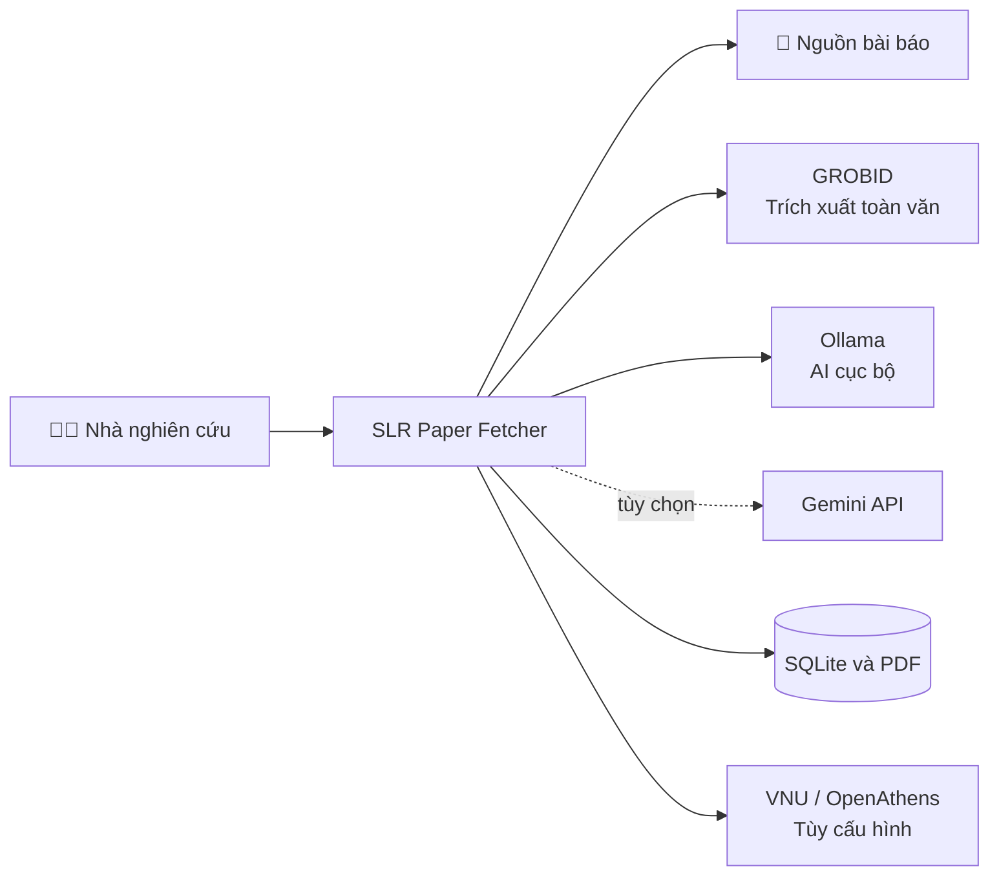

<div align="center">
  <h1>SLR Paper Fetcher</h1>
  <p><strong>Nền tảng hỗ trợ thu thập, quản lý và rà soát bài báo khoa học cho systematic literature review.</strong></p>
  <p>
    
    
    
  </p>
  <p>
    <a href="#docker">🚀 Cài bằng Docker</a> &nbsp;·&nbsp;
    <a href="#native">💻 Cài trực tiếp</a> &nbsp;·&nbsp;
    <a href="#features">✨ Khám phá tính năng</a>
  </p>
</div>

SLR Paper Fetcher nhận DOI, tải các bản PDF có thể truy cập, quản lý thư viện bài báo và tạo bản phân tích có thể truy ngược về văn bản nguồn. Ứng dụng kết hợp **GROBID** để trích xuất toàn văn với **Ollama** chạy cục bộ hoặc **Gemini API** để hỗ trợ phân tích.

> [!IMPORTANT]
> Kết quả AI là bản nháp phục vụ rà soát. Người nghiên cứu cần kiểm tra trích dẫn và nội dung nguồn; cấu trúc lập luận không tự chứng minh tính đúng đắn khoa học.

## 🧭 Mục lục

- [✨ Tính năng](#features)
- [🧩 Kiến trúc](#architecture)
- [🐳 Cài và chạy bằng Docker](#docker)
- [💻 Cài và chạy trực tiếp](#native)
- [🤖 Chọn AI provider](#ai-provider)
- [⚙️ Cấu hình](#configuration)
- [💾 Lưu trữ và sao lưu](#data)
- [🩺 Khắc phục sự cố](#troubleshooting)
- [🔗 Tài liệu tham khảo](#references)

<a id="features"></a>
## ✨ Tính năng

| | Khả năng | Mô tả |
|---|---|---|
| 🔎 | **Tìm và tải bài báo** | Nhận DOI đơn lẻ, danh sách DOI, CSV hoặc Excel; thử các nguồn truy cập mở và VNU/OpenAthens đã cấu hình. |
| 📚 | **Thư viện PDF** | Theo dõi trạng thái tải, quản lý tệp và xuất trích dẫn RIS. |
| ☁️ | **Đồng bộ SLR System** | Chọn dự án đích và gửi bài báo đã lưu qua API. |
| 🧠 | **Phân tích toàn văn** | Trích xuất nội dung bằng GROBID; phân tích bằng Ollama cục bộ hoặc Gemini API. |
| 🕸️ | **Rà soát lập luận** | Xem nguồn trích dẫn, Toulmin Model và AIF Graph; rà soát các đề xuất AI. |
| 💾 | **Tiếp tục công việc** | Lưu bản phân tích, lịch sử và trạng thái hàng đợi trong SQLite. |

<a id="architecture"></a>
## 🧩 Kiến trúc



<a id="docker"></a>
## 🐳 Cài và chạy bằng Docker

### Yêu cầu

- **Windows/macOS:** Docker Desktop đã cài và đang chạy.
- **Linux:** Docker Engine và Docker Compose plugin.
- Internet trong lần đầu để tải container images và Chromium.
- Dung lượng phù hợp cho Ollama model nếu chọn phân tích cục bộ.

### Bước 1 — Tạo cấu hình

Nếu chưa có `.env`, tạo từ mẫu:

**Windows · PowerShell**

```powershell
if (-not (Test-Path .env)) { Copy-Item .env.example .env }
```

**macOS · Linux**

```bash
[ -f .env ] || cp .env.example .env
```

Điền `VNU_LIBRARY_ID` và `VNU_LIBRARY_PASSWORD` trong `.env` nếu cần dùng quyền truy cập thư viện. Có thể để trống để bắt đầu với nguồn truy cập mở hoặc Gemini.

### Bước 2 — Khởi động ứng dụng

```bash
docker compose up --build -d
```

Mở **[http://localhost:8543](http://localhost:8543)**. Ứng dụng chỉ lắng nghe trên máy cục bộ theo mặc định.

### Bước 3 — Cấu hình AI

**Ollama · chạy cục bộ**

Tải model mặc định một lần:

```bash
docker compose exec ollama ollama pull qwen2.5:7b
```

**Gemini · API**

Mở **Settings**, chọn **Gemini API** và dán API key. Key được giữ trong cấu hình cục bộ của volume ứng dụng và không được trả lại cho trình duyệt.

### Lệnh Docker thường dùng

```bash
# Theo dõi log web app
docker compose logs -f web

# Dừng container, giữ nguyên volumes
docker compose down
```

Để đổi cổng host, thêm `WEB_PORT=9000` vào `.env`. Không dùng `docker compose down -v` nếu cần giữ database, PDF, browser profile và Ollama models.

<a id="native"></a>
## 💻 Cài và chạy trực tiếp

Cần **Python 3.10 trở lên**, **Node.js 22.12 trở lên** và npm. Bundle giao diện Toulmin được biên dịch bằng Vite trước khi chạy ứng dụng.

**Windows · PowerShell**

```powershell
python -m venv .venv
.venv\Scripts\Activate.ps1
npm ci
npm run build
python -m pip install -r requirements.txt
python -m playwright install chromium
if (-not (Test-Path .env)) { Copy-Item .env.example .env }
python app.py
```

**macOS**

```bash
python3 -m venv .venv
source .venv/bin/activate
npm ci
npm run build
python -m pip install -r requirements.txt
python -m playwright install chromium
[ -f .env ] || cp .env.example .env
python app.py
```

**Linux**

```bash
python3 -m venv .venv
source .venv/bin/activate
npm ci
npm run build
python -m pip install -r requirements.txt
python -m playwright install --with-deps chromium
[ -f .env ] || cp .env.example .env
python app.py
```

Mở **[http://127.0.0.1:8543](http://127.0.0.1:8543)**. GROBID và Ollama là các dịch vụ riêng; cập nhật `GROBID_URL` hoặc `OLLAMA_URL` trong `.env` nếu chúng chạy ở địa chỉ khác. Trên Windows, `run_app.bat` cũng cài frontend dependencies, build asset, cài Python dependencies và Chromium trước khi chạy.

<a id="ai-provider"></a>
## 🤖 Chọn AI provider

| Provider | Cần chuẩn bị | Cách bật |
|---|---|---|
| 🖥️ **Ollama** | Dịch vụ Ollama và model đã tải | Chọn Ollama trong **Settings**; Docker Compose dùng `qwen2.5:7b` mặc định. |
| ☁️ **Gemini API** | Gemini API key | Chọn Gemini trong **Settings** và nhập key. |

<a id="configuration"></a>
## ⚙️ Cấu hình

| Biến | Mặc định | Chức năng |
|---|---|---|
| `VNU_LIBRARY_ID`, `VNU_LIBRARY_PASSWORD` | Trống | Tài khoản thư viện VNU/OpenAthens. |
| `VNU_OPENATHENS_BASE_URL` | URL OpenAthens của VNU | Địa chỉ chuyển tiếp qua thư viện. |
| `GROBID_URL` | `http://127.0.0.1:8070` native | Dịch vụ trích xuất toàn văn. |
| `AI_DEFAULT_PROVIDER` | `ollama` | Provider phân tích mặc định. |
| `OLLAMA_URL` | `http://127.0.0.1:11434` native | Địa chỉ dịch vụ Ollama. |
| `OLLAMA_MODEL` | `qwen2.5:7b` | Tên model Ollama. |
| `GEMINI_API_KEY` | Trống | Gemini key; có thể nhập trong **Settings**. |
| `GEMINI_MODEL` | `gemini-2.5-flash` | Tên model Gemini. |
| `APP_HOST`, `APP_PORT` | `127.0.0.1`, `8543` | Host và cổng khi chạy native. |
| `DOWNLOAD_FOLDER` | `./downloads` | Nơi lưu PDF khi chạy native. |
| `SLR_API_BASE_URL` | `http://127.0.0.1:5000` | Địa chỉ SLR System. |
| `SLR_PUBLIC_API_KEY`, `SLR_DEFAULT_PROJECT_ID` | Theo cấu hình | API key và dự án mặc định của SLR System. |

Trong Docker Compose, web app truy cập GROBID tại `http://grobid:8070` và Ollama tại `http://ollama:11434`. Các giá trị AI trong **Settings** được lưu trong volume `app-data` và giữ nguyên sau khi container khởi động lại.

Để kết nối SLR System, dùng nút **Cấu hình API** trong ứng dụng. Backend phải truy cập được từ container; trên Docker Desktop, địa chỉ host thường dùng `http://host.docker.internal:<port>`.

<a id="data"></a>
## 💾 Lưu trữ và sao lưu

| Nội dung | Chạy native | Docker Compose |
|---|---|---|
| Database và phân tích | `data/papers.sqlite3` | Volume `app-data` |
| PDF đã tải | `downloads/` | Volume `paper-downloads` |
| Cấu hình Settings | `.env` | File cấu hình trong volume `app-data` |
| Browser profile | `.vnu-browser-profile/` | Volume `browser-profile` |
| Ollama models | Theo cấu hình Ollama | Volume `ollama-models` |

Dữ liệu native và Docker tách biệt, không tự đồng bộ. Sao lưu thư mục hoặc volumes tương ứng trước khi chuyển máy.

<a id="troubleshooting"></a>
## 🩺 Khắc phục sự cố

| Vấn đề | Cách xử lý |
|---|---|
| Ollama báo thiếu model | Chạy `docker compose exec ollama ollama pull qwen2.5:7b` hoặc tải model đang chọn. |
| Không kết nối GROBID | Kiểm tra `docker compose ps` và `docker compose logs grobid`. |
| Cổng 8543 đang được dùng | Đổi `WEB_PORT` trong `.env`, rồi khởi động lại Compose. |
| Cần xác minh CAPTCHA thủ công | Docker chạy Chromium headless; chạy native để mở cửa sổ browser tương tác. |
| Chạy trên máy ARM | Image GROBID CRF hiện nhắm tới `linux/amd64`; giả lập có thể chậm hơn. |
| Không tìm thấy PDF | Khả năng truy cập tùy nguồn mở hoặc quyền thư viện đã cấu hình. |

<a id="references"></a>
## 🔗 Tài liệu tham khảo

- [GROBID · Docker](https://github.com/grobidOrg/grobid/blob/master/doc/Grobid-docker.md)
- [Ollama · Docker image](https://github.com/ollama/ollama#docker)
- [Playwright Python · Docker](https://playwright.dev/python/docs/docker)
- [Docker Compose · Quickstart](https://docs.docker.com/compose/gettingstarted/)
